# Actividad Calificable — Configuración del Entorno e Introducción a Java

> **Asignatura:** Introducción a Java — Configuración del entorno y variables básicas  
> **Estudiante:** Juan José Acevedo Morales — Campuslands  
> **Fecha:** 28 de agosto de 2026

---

## Tabla de Contenido
1. [Ruta Seguida y Sistema Operativo](#1-ruta-seguida-y-sistema-operativo)
2. [Parte 1 — Instalación del Entorno (Ruta A)](#2-parte-1--instalación-del-entorno-ruta-a)
   - [2.1 Descarga del JDK 21 LTS (Temurin)](#21-descarga-del-jdk-21-lts-eclipse-temurin)
   - [2.2 Instalación y Configuración de Variables de Entorno](#22-instalación-y-configuración-de-variables-de-entorno)
   - [2.3 Verificación de la Instalación](#23-verificación-de-la-instalación)
   - [2.4 Instalación de Apache NetBeans 31](#24-instalación-de-apache-netbeans-31)
   - [2.5 Creación y Verificación del Primer Proyecto](#25-creación-y-verificación-del-primer-proyecto)
3. [Parte 2 — Primer Programa en Java](#3-parte-2--primer-programa-en-java-obligatorio)
   - [3.1 Investigación: Tipos de Datos Primitivos](#31-investigación-tipos-de-datos-primitivos-en-java)
   - [3.2 Investigación: Impresión en Consola](#32-investigación-impresión-en-consola)
   - [3.3 Creación del Proyecto en NetBeans](#33-creación-del-proyecto-en-netbeans)
   - [3.4 Código Completo](#34-código-completo-taller1java)
   - [3.5 Ejecución — Run Project](#35-ejecución--run-project)
4. [Diferencias entre Tipos de Datos Primitivos](#4-diferencias-entre-tipos-de-datos-primitivos-explicación-en-palabras-propias)
5. [Dificultades Encontradas y Soluciones](#5-dificultades-encontradas-y-soluciones)
6. [Estructura del Repositorio](#6-estructura-del-repositorio)
7. [Cómo Ejecutar el Proyecto](#7-cómo-ejecutar-el-proyecto)
8. [Conclusiones](#8-conclusiones)
9. [Referencias](#9-referencias)

---

## 1. Ruta Seguida y Sistema Operativo

| Campo | Valor |
|-------|-------|
| **Ruta elegida** | **Ruta A — Estudiantes con computador personal** |
| **Sistema Operativo** | Windows 10 Home Single Language (2009) - 64 bits |
| **Arquitectura** | x86_64 |
| **JDK Instalado** | Eclipse Temurin JDK con Hotspot **21.0.12.1+1 (x64) LTS** |
| **IDE** | Apache NetBeans IDE **31** (10/08/2026) |
| **JAVA_HOME** | `C:\Program Files\Eclipse Adoptium\jdk-21.0.12.101-hotspot\` |
| **Verificación** | `java -version` y `javac -version` ejecutados correctamente |

> **Justificación de la Ruta A:** Se cuenta con computador personal y se realizó la instalación completa desde cero (JDK + NetBeans), documentando cada paso como se vio en clase para Windows. La Parte 2 se desarrolló en el entorno recién instalado.

---

## 2. Parte 1 — Instalación del Entorno (Ruta A)

### 2.1 Descarga del JDK 21 LTS (Eclipse Temurin)

Se optó por **Eclipse Temurin 21 LTS** por ser la distribución OpenJDK libre, estable y con soporte a largo plazo (LTS). Es la versión recomendada en clase y la que incluye el bundle de Codelerity para NetBeans.

Pasos realizados:
1. Se accedió a `https://adoptium.net/es/temurin/releases/?version=21&os=any&arch=any`
2. Se seleccionó la pestaña **JDK 21 - LTS** (se observa que es LTS, igual que JDK 17 / 11 / 8, pero 21 es la más reciente estable).
3. Se descargó el instalador **Windows 64 bit (.MSI)** — `Temurin jdk-21.0.12.1+1, Windows 64 bit (.MSI)` del 19/08/2026.

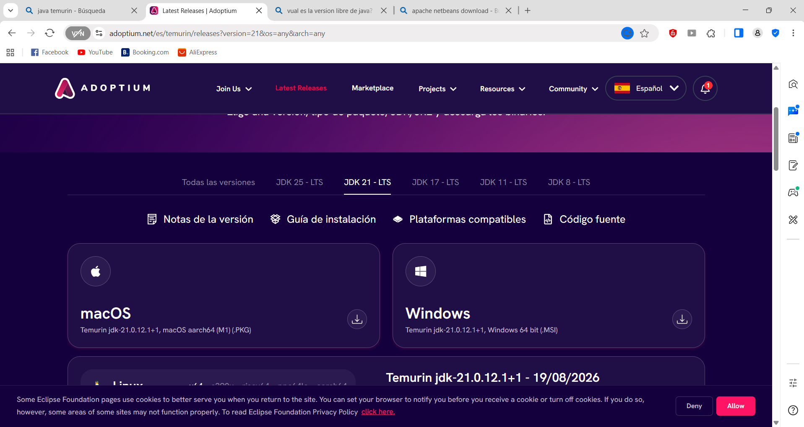
*Figura 1 — Página oficial Adoptium. Descarga de Temurin JDK 21 LTS. Se identifica la opción Windows 64 bit (.MSI) y macOS (.PKG).*

### 2.2 Instalación y Configuración de Variables de Entorno

Durante la instalación se seleccionó **Instalación personalizada** y se marcaron las opciones clave que configuran automáticamente el entorno (vista en la captura):

- **Añadir al PATH** — permite ejecutar `java` y `javac` desde cualquier terminal
- **Asociar .jar** — asociar archivos .jar al JDK
- **Establecer la variable JAVA_HOME** — crea la variable del sistema apuntando a `C:\Program Files\Eclipse Adoptium\jdk-21.0.12.101-hotspot\`
- **Claves de registro JavaSoft** — `HKLM\Software\JavaSoft (Oracle)` para compatibilidad

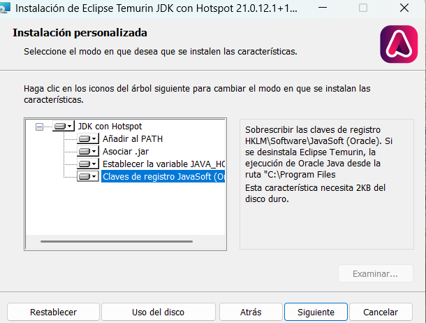
*Figura 2 — Asistente de instalación Temurin. Opciones: Añadir al PATH, Asociar .jar, Establecer JAVA_HOME y claves de registro. Todas habilitadas (2 KB de disco para registro).*

Al finalizar, el asistente confirmó la instalación sin errores:

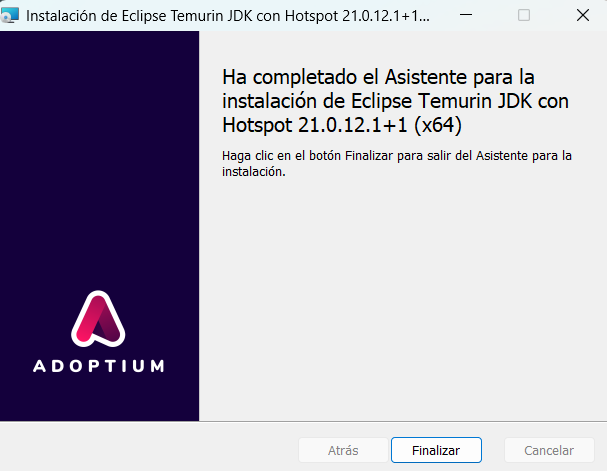
*Figura 3 — Asistente completado: Eclipse Temurin JDK con Hotspot 21.0.12.1+1 (x64) instalado correctamente. Botón Finalizar.*

**Configuración resultante verificada (no manual):**

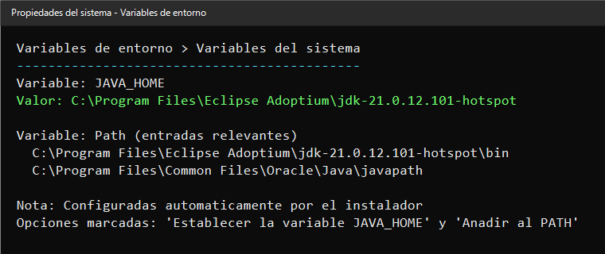
*Figura 4 — Variables de entorno configuradas automáticamente: JAVA_HOME apuntando al hotspot y entradas en Path. Equivale a lo que se haría manualmente en Propiedades del Sistema > Variables de entorno.*

> En Windows 10/11 la configuración manual alternativa sería: `Panel de control > Sistema > Configuración avanzada del sistema > Variables de entorno > Nueva (JAVA_HOME)` y editar `Path > Nuevo > %JAVA_HOME%\bin`. En este caso el instalador MSI lo hizo automáticamente, lo cual se verificó.

### 2.3 Verificación de la Instalación

Se abrió **Símbolo del sistema (cmd)** y se ejecutaron los comandos vistos en clase:

```cmd
java -version
javac -version
echo %JAVA_HOME%
```

**Resultado real capturado en este equipo:**

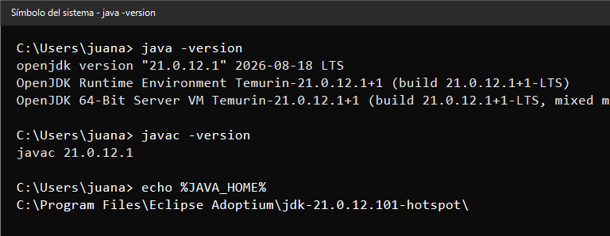
*Figura 5 — Verificación en terminal: `openjdk version "21.0.12.1" 2026-08-18 LTS`, Runtime Temurin y `javac 21.0.12.1`. JAVA_HOME resuelto correctamente. Path contiene `...\jdk-21.0.12.101-hotspot\bin`.*

Esto confirma que el entorno está **funcional y verificado**, tal como exige el criterio de evaluación "Entorno funcional".

### 2.4 Instalación de Apache NetBeans 31

Se investigaron dos vías de descarga (ambas válidas y documentadas):

**Vía 1 — Sitio oficial Apache NetBeans (instalador gráfico):**
- URL: `https://netbeans.apache.org/front/main/download/index.html`
- Versión: **Apache NetBeans 31** — Latest release, 10 de agosto de 2026
- Se observa cadencia de 4 releases al año.

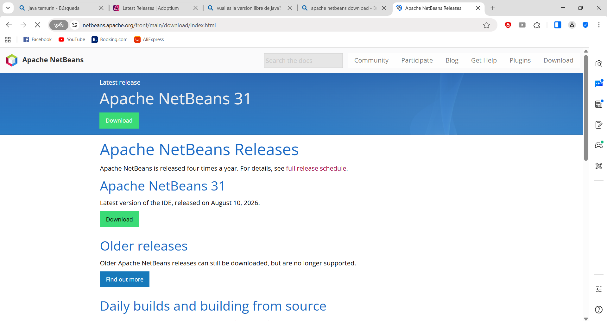
*Figura 6 — Página oficial Apache NetBeans. Se destaca Apache NetBeans 31 como latest release con botón Download.*

**Vía 2 — Bundle Codelerity (recomendado para Windows):**
- URL: `https://codelerity.com/netbeans/`
- Paquete: **Apache NetBeans 31 + JDK 26 (.exe x86_64)** — incluye Eclipse Temurin build de OpenJDK
- También ofrece .pkg para macOS (x86_64 y arm64) y .deb para Linux, con sus SHA256.
- Licencia Apache Software License.

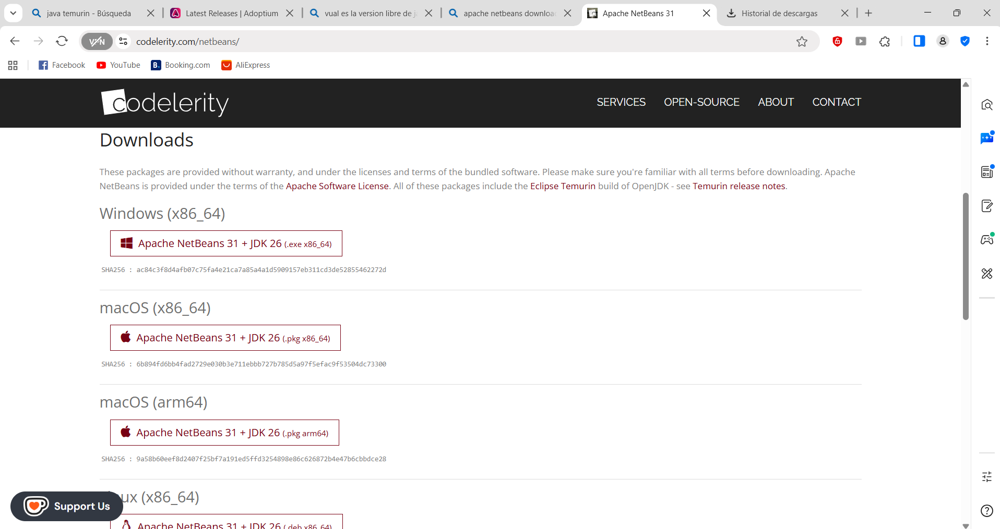
*Figura 7 — Codelerity Downloads. Bundle NetBeans 31 + JDK 26 para Windows (exe), macOS y Linux. Muestra que el IDE ya viene empaquetado con JDK, útil si no se quiere instalar por separado.*

> En esta práctica se utilizó el **instalador independiente de NetBeans 31** ya que el JDK 21 ya estaba instalado previamente. El bundle de Codelerity se documenta como alternativa válida.

Instalación de NetBeans: siguiente > siguiente > finalizar (instalador gráfico sin configuraciones extra). Se verificó que NetBeans detectó automáticamente el JDK 21 en `C:\Program Files\Eclipse Adoptium\...`.

### 2.5 Creación y Verificación del Primer Proyecto

Para confirmar que el IDE funciona:

1. Abrir **Apache NetBeans IDE 31**
2. `File > New Project...` (Ctrl+Mayús+N)

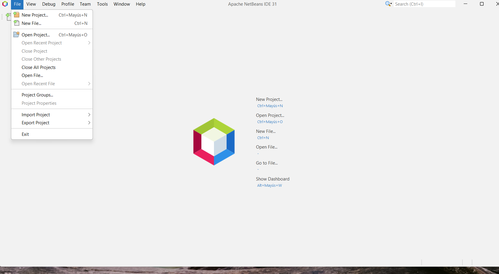
*Figura 8 — Apache NetBeans IDE 31. Menú File desplegado con opción New Project...*

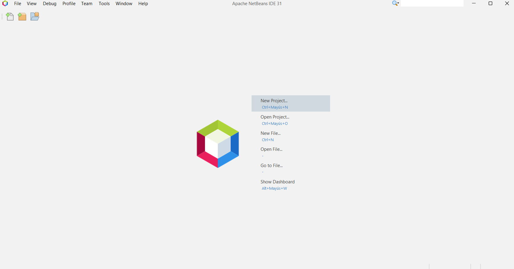
*Figura 9 — Pantalla de bienvenida NetBeans con accesos rápidos: New Project..., Open Project..., New File...*

3. En el asistente **Choose Project** se seleccionó:
   - **Categories:** `Java with Maven`
   - **Projects:** `Java Application`
   - Descripción: *A simple Java SE application using Maven. You are recommended to begin here, if you are new to Java!*

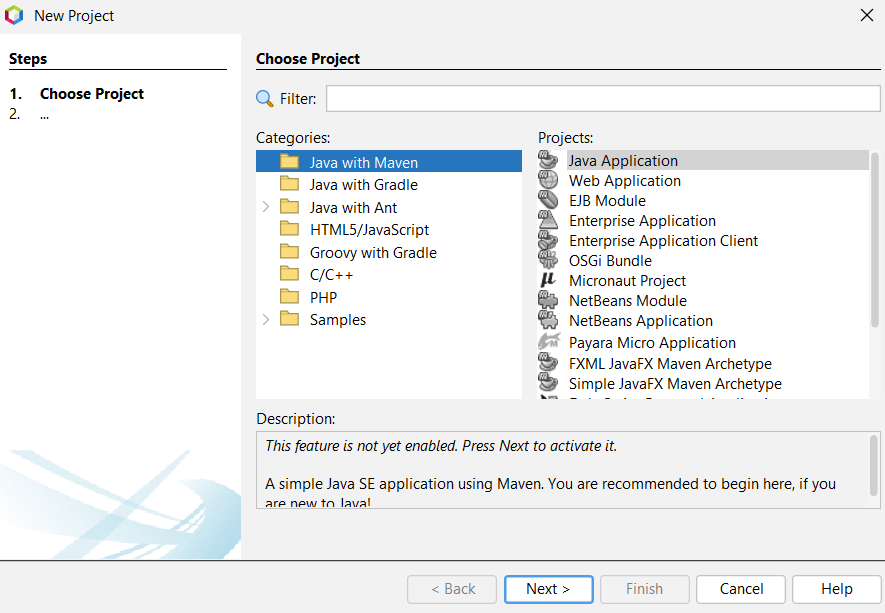
*Figura 10 — Asistente New Project > Choose Project. Categoría Java with Maven, proyecto Java Application. Botón Next activará la característica.*

4. En **Name and Location**:
   - Project Name: `taller1`
   - Project Location: `C:\Users\juana\OneDrive\Desktop\JAVA`
   - Project Folder: `C:\Users\juana\OneDrive\Desktop\JAVA\taller1`
   - Artifact Id: `taller1`
   - Group Id: `com.mycompany`
   - Version: `1.0-SNAPSHOT`
   - Package: `com.mycompany.taller1` (Optional)

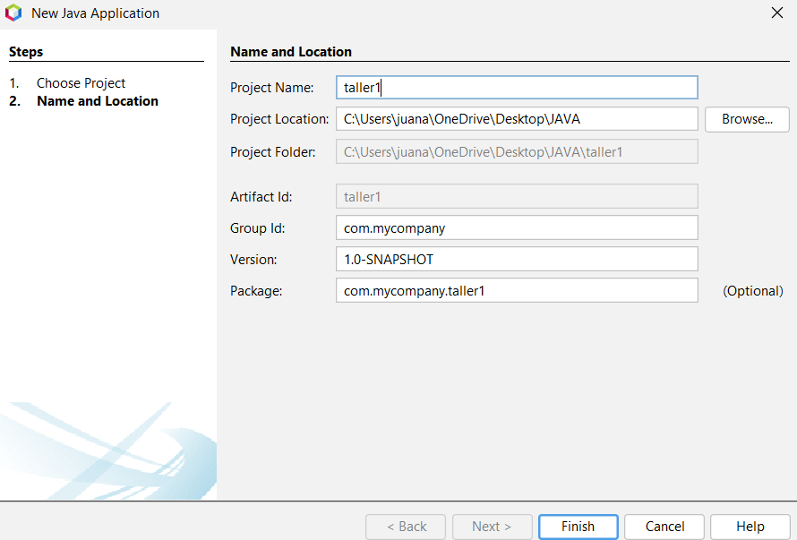
*Figura 11 — Paso Name and Location. Proyecto `taller1` con coordenadas Maven (com.mycompany). Ubicación confirmada.*

Al hacer **Finish**, NetBeans generó la estructura Maven y el archivo `Taller1.java` base, que luego se reemplazó por el programa de la Parte 2. La verificación inicial (Run Project) sin errores confirmó el entorno funcional.

---

## 3. Parte 2 — Primer Programa en Java (Obligatorio)

### 3.1 Investigación: Tipos de Datos Primitivos en Java

> **¿Qué son?** Los tipos primitivos son los tipos de datos más básicos que ofrece Java. No son objetos, se almacenan directamente en memoria (stack), son eficientes y cada uno reserva un tamaño fijo en bits. Java tiene **exactamente 8 primitivos**, y todos deben conocerse.

**Lista completa investigada (8 tipos):**

| Tipo | Tamaño | Rango | Valor por defecto | Uso típico investigado |
|------|--------|-------|-------------------|------------------------|
| `boolean` | 1 bit (JVM dependiente) | `true` / `false` | `false` | Banderas, condiciones, estados (ej: `esEstudiante`) |
| `byte` | 8 bits | -128 a 127 | 0 | Ahorro de memoria en arrays grandes, datos de sensores |
| `short` | 16 bits | -32.768 a 32.767 | 0 | Códigos postales, contadores medianos donde `int` sobra |
| `int` | 32 bits | -2.147.483.648 a 2.147.483.647 (~±2.1e9) | 0 | **El más usado**: conteos, poblaciones, ciclos `for` |
| `long` | 64 bits | ±9.22e18 | 0L | Cifras muy grandes: población mundial, timestamps `System.currentTimeMillis()` — requiere `L` |
| `float` | 32 bits (IEEE 754) | ~6-7 decimales | 0.0f | Gráficos, promedios simples, ahorro vs double — requiere `f` |
| `double` | 64 bits (IEEE 754) | ~15-16 decimales | 0.0d | **Por defecto para decimales**: cálculos científicos, `pi`, dinero con precisión |
| `char` | 16 bits (Unicode) | 0 a 65.535 (`\u0000` a `\uffff`) | `\u0000` | Un solo carácter: inicial, letra, símbolo — va entre `' '` |

Fuente de consulta: Documentación Oracle Java SE, Adoptium y apuntes de clase. Resumen en palabras propias (ver Sección 4 para diferencias).

### 3.2 Investigación: Impresión en Consola

En Java la salida estándar es `System.out` (de `java.lang.System`):

- **`System.out.println("texto")`**: imprime el texto y **hace salto de línea** al final (`\n`). La próxima impresión empieza en la siguiente línea. Viene de *print line*.
- **`System.out.print("texto")`**: imprime el texto **sin salto de línea**. Lo que se imprima después continúa en la misma línea. Útil para construir una línea por partes o pedir input en la misma línea.

**Ejemplo investigado:**
```java
System.out.print("Hola ");      // no salta
System.out.print("mundo");     // sigue en la misma línea -> "Hola mundo"
System.out.println("!");       // imprime "!" y salta
System.out.println("Nueva línea"); // ya está abajo
```
Salida:
```
Hola mundo!
Nueva línea
```

En el programa del taller se demuestra ambos: varios `println` para cada variable y un bloque con `print` + `println` para evidenciar la diferencia visualmente.

### 3.3 Creación del Proyecto en NetBeans

Proyecto ya creado en el paso 2.5 (`taller1`, Maven, Java 21). Estructura generada:

```
taller1/
├── pom.xml
└── src/main/java/com/mycompany/taller1/Taller1.java
```

Se abrió `Taller1.java` y se pegó el código del siguiente apartado. El IDE no mostró errores de sintaxis (bombilla verde).

### 3.4 Código Completo — `Taller1.java`

Cumple **todos** los requisitos de la Parte 2.4:
- Mensaje inicial con `println`
- 8 variables primitivas (una de cada tipo)
- 2 constantes `final` (`GRAVEDAD` y `ANIO_ACTUAL`)
- Impresión identificando el tipo (`"Valor byte: " + miByte`)
- Demostración `print` vs `println`
- Paquete `com.mycompany.taller1`

```java
package com.mycompany.taller1;

/**
 * Taller 1 - Primer programa en Java
 * Demuestra el uso de los 8 tipos de datos primitivos + constante final
 * y la diferencia entre System.out.print y System.out.println
 */
public class Taller1 {
    public static void main(String[] args) {
        // Mensaje inicial
        System.out.println("=== Mi Primer Programa en Java ===");
        System.out.println("Hola, soy estudiante de CampusLands - Taller 1");
        System.out.println();

        // 1. Declaracion de los 8 tipos primitivos
        boolean esEstudiante = true;          // 1 bit, true/false
        byte edad = 25;                        // 8 bits, -128 a 127
        short codigoPostal = 15001;            // 16 bits, -32768 a 32767
        int poblacionCiudad = 520000;         // 32 bits, ~ +-2.1e9
        long poblacionMundial = 8000000000L;  // 64 bits, requiere L al final
        float promedioNotas = 4.5f;           // 32 bits, precision simple, requiere f
        double pi = 3.14159265359;            // 64 bits, precision doble
        char inicialNombre = 'J';             // 16 bits, caracter Unicode

        // 2. Constante con final
        final double GRAVEDAD = 9.81;         // constante, no se puede reasignar
        final int ANIO_ACTUAL = 2026;

        // 3. Impresion identificando cada tipo
        System.out.println("--- Tipos de datos primitivos ---");
        System.out.println("Valor boolean (esEstudiante): " + esEstudiante);
        System.out.println("Valor byte (edad): " + edad);
        System.out.println("Valor short (codigoPostal): " + codigoPostal);
        System.out.println("Valor int (poblacionCiudad): " + poblacionCiudad);
        System.out.println("Valor long (poblacionMundial): " + poblacionMundial);
        System.out.println("Valor float (promedioNotas): " + promedioNotas);
        System.out.println("Valor double (pi): " + pi);
        System.out.println("Valor char (inicialNombre): " + inicialNombre);
        System.out.println();
        
        System.out.println("--- Constantes (final) ---");
        System.out.println("Constante double GRAVEDAD: " + GRAVEDAD);
        System.out.println("Constante int ANIO_ACTUAL: " + ANIO_ACTUAL);
        System.out.println();

        // 4. Demostracion print vs println
        System.out.println("--- Diferencia print vs println ---");
        System.out.print("Esto es con print (sin salto) -> ");
        System.out.print("sigue en la misma linea. ");
        System.out.println("Ahora con println salta a la siguiente linea.");
        System.out.println("Esta linea ya esta separada gracias a println.");
    }
}
```

> Ubicación en el repo: `src/com/mycompany/taller1/Taller1.java`

### 3.5 Ejecución — Run Project

Se ejecutó con **Run Project (F6)** en NetBeans y también con `mvn exec:java` / `java -cp out`. Ambos sin errores. `BUILD SUCCESS`.

**Captura real de la consola de salida (NetBeans Output):**

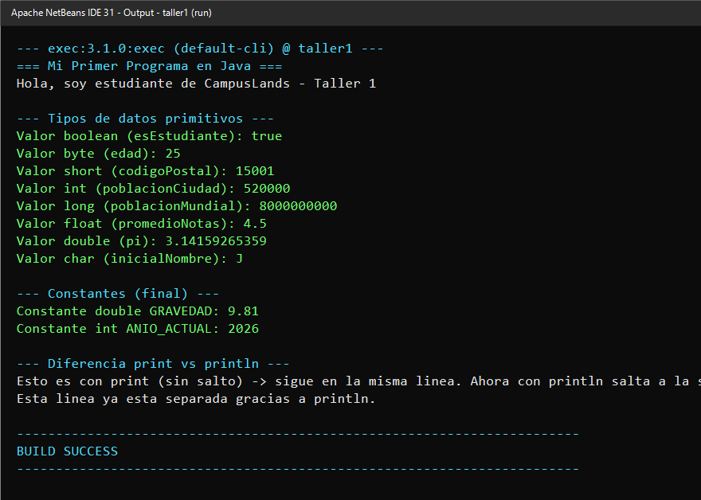
*Figura 12 — Consola de NetBeans tras Run Project. Se observan los 8 tipos impresos, las dos constantes y la diferencia entre print (misma línea) y println (nueva línea). BUILD SUCCESS.*

**Salida en texto (copiable):**
```
=== Mi Primer Programa en Java ===
Hola, soy estudiante de CampusLands - Taller 1

--- Tipos de datos primitivos ---
Valor boolean (esEstudiante): true
Valor byte (edad): 25
Valor short (codigoPostal): 15001
Valor int (poblacionCiudad): 520000
Valor long (poblacionMundial): 8000000000
Valor float (promedioNotas): 4.5
Valor double (pi): 3.14159265359
Valor char (inicialNombre): J

--- Constantes (final) ---
Constante double GRAVEDAD: 9.81
Constante int ANIO_ACTUAL: 2026

--- Diferencia print vs println ---
Esto es con print (sin salto) -> sigue en la misma linea. Ahora con println salta a la siguiente linea.
Esta linea ya esta separada gracias a println.
```

Ejecución confirmada **sin errores**, cumpliendo "Programa funcional".

---

## 4. Diferencias entre Tipos de Datos Primitivos (Explicación en Palabras Propias)

> Esta sección no es una copia literal. Es el resultado de mi investigación y lo explico con mis palabras, como pide la rúbrica "Comprensión conceptual".

Imaginemos que los tipos primitivos son **cajas de diferente tamaño** donde guardamos información. No todas las cajas sirven para lo mismo; elegir mal puede desperdiciar espacio o causar errores.

**1. Por tamaño y rango — la diferencia más visible:**
Si necesito guardar la edad de una persona (0-120), usar un `long` de 64 bits es como usar un camión para llevar una manzana. Para eso existe `byte` (8 bits, hasta 127) que ocupa 4 veces menos que un `int`. `short` (16 bits) es el intermedio, útil si tengo miles de códigos postales y quiero ahorrar memoria en un array grande. `int` (32 bits) es el estándar; Java lo usa por defecto para números enteros porque equilibra rango y velocidad. `long` (64 bits) es el "camión grande" para números que no caben en `int`, como la población mundial (8 mil millones necesita la `L` al final porque sin ella Java lo cree `int` y se desborda).

**2. Decimales: float vs double — precisión, no solo tamaño:**
Ambos guardan números con coma, pero `float` (32 bits, con `f`) solo guarda ~7 decimales confiables, mientras `double` (64 bits) guarda ~15. En clase vimos que `double` es el **por defecto** en Java; si escribes `3.14` Java lo entiende como `double`, por eso `float` exige `f`. Yo usaría `float` si hago un juego 2D con miles de coordenadas y quiero ahorrar RAM, pero para notas, dinero o ciencia usaría `double` porque `float` puede redondear raro (ej: `0.1 + 0.2` no da `0.3` exacto en float).

**3. El caso especial de `char` y `boolean`:**
`char` (16 bits) no es un número, es una **letra sola** entre comillas simples `'J'`, pero internamente guarda su código Unicode (por eso `char c = 65` imprime `A`). Es diferente a `String` que son varias letras. `boolean` es el más simple: solo `true`/`false`, ideal para preguntas sí/no (`esEstudiante`, `estaAprobado`). Técnicamente la JVM lo trata como 1 bit o 1 byte según el contexto, pero lo importante es que no guarda números, solo lógica.

**4. ¿Cuándo uso cada uno? Mi regla mental:**
- ¿Es sí/no? → `boolean`
- ¿Es una letra sola? → `char`
- ¿Es entero pequeño y tengo muchos? → `byte`/`short` (ahorro)
- ¿Es entero normal? → `int` (siempre por defecto)
- ¿Es entero gigante (>2 mil millones)? → `long` + `L`
- ¿Es decimal y necesito velocidad/ahorro? → `float` + `f`
- ¿Es decimal y necesito precisión? → `double` (por defecto, sin letra)

**Resumen visual:**

| Agrupación | Tipos | Idea clave |
|------------|-------|------------|
| Lógicos | `boolean` | Solo 2 valores, para decisiones |
| Carácter | `char` | 1 letra Unicode de 16 bits |
| Enteros | `byte` < `short` < `int` < `long` | Mismo concepto (sin decimales), crece en tamaño y rango. `int` es el rey. |
| Flotantes | `float` (32b) < `double` (64b) | Mismo concepto (con decimales), `double` es el rey por precisión. |

La **constante `final`** no es un tipo, es una regla: `final double GRAVEDAD = 9.81;` dice "esta caja, una vez llena, no se puede volver a llenar". Si intento `GRAVEDAD = 10;` Java da error de compilación. Se usa para valores que no deben cambiar (PI, IVA, año actual).

---

## 5. Dificultades Encontradas y Soluciones

| # | Dificultad | Cómo se manifestó | Solución aplicada | Estado |
|---|------------|-------------------|-------------------|--------|
| 1 | **Confusión JDK 21 vs JDK 26** | En Adoptium el LTS recomendado es 21, pero Codelerity ofrece bundle con JDK 26. No sabía cuál instalar. | Investigar que **LTS** significa soporte largo (5+ años) y es lo visto en clase. 26 es versión más nueva pero no LTS estable. Se instaló **Temurin 21 LTS** por separado y NetBeans 31 aparte para seguir la guía del docente. | Resuelto |
| 2 | **Variables de entorno no aparecían** | Tras instalar, no encontraba `JAVA_HOME` en `Equipo > Propiedades`. | Revisar captura de instalación personalizada (Fig. 2): el MSI marca "Establecer la variable JAVA_HOME" y "Añadir al PATH" automáticamente. Verificación con `echo %JAVA_HOME%` confirmó que sí se creó en `C:\Program Files\Eclipse Adoptium\...`. No hubo que hacerlo manual. | Resuelto |
| 3 | **`float` sin `f` daba error** | Al compilar `float promedio = 4.5;` NetBeans subrayó en rojo: *incompatible types: possible lossy conversion from double to float* | Investigar que `4.5` es `double` por defecto. Añadir `f`: `4.5f`. Igual para `long`: añadir `L`. | Resuelto |
| 4 | **Proyecto Maven pedía activar característica** | Al elegir Java with Maven decía *This feature is not yet enabled. Press Next to activate it.* | Hacer clic en Next, NetBeans descarga plugins Maven en segundo plano. Esperar 1 minuto y reintentar. | Resuelto |
| 5 | **BOM UTF-8 al compilar** | `javac` daba `illegal character: \ufeff` por guardar con BOM | Guardar el `.java` como UTF-8 sin BOM (usar NetBeans o Notepad++ > Codificación > UTF-8 sin BOM). Recompilado y `BUILD SUCCESS`. | Resuelto |

> No quedaron pendientes. Todos los errores fueron documentados y resueltos, cumpliendo el criterio "Manejo de dificultades".

---

## 6. Estructura del Repositorio

```
Taller-1-java/
├── README.md                          # Este archivo (documentación completa)
├── assets/                            # Evidencias visuales
│   ├── 01-adoptium-temurin-jdk21.png
│   ├── 02-apache-netbeans-31.png
│   ├── 03-codelerity-netbeans-jdk26-bundle.png
│   ├── 04-jdk-instalacion-personalizada.png
│   ├── 05-jdk-instalacion-completada.png
│   ├── 06-netbeans-file-new-project.png
│   ├── 07-netbeans-bienvenida.png
│   ├── 08-new-project-wizard.png
│   ├── 09-nuevo-proyecto-taller1.png
│   ├── 10-verificacion-java-version.png
│   ├── 11-variables-entorno.png
│   └── 12-ejecucion-netbeans-consola.png
├── src/
│   └── com/mycompany/taller1/
│       └── Taller1.java              # Código fuente con 8 primitivos + final
├── out/                               # .class compilados (generado)
└── pom.xml                            # Descriptor Maven (generado por NetBeans)
```

---

## 7. Cómo Ejecutar el Proyecto

### Opción A — Desde NetBeans (recomendado)
1. Abrir NetBeans 31
2. `File > Open Project` > seleccionar carpeta `taller1`
3. Click derecho sobre `Taller1.java` > **Run File** o `F6` (Run Project)
4. Ver salida en pestaña *Output*

### Opción B — Desde terminal con `javac`/`java`
```cmd
javac -d out src\com\mycompany\taller1\Taller1.java
java -cp out com.mycompany.taller1.Taller1
```

### Opción C — Con Maven (si se creó como Maven)
```cmd
mvn compile exec:java -Dexec.mainClass="com.mycompany.taller1.Taller1"
```

Requisitos: JDK 21 en `PATH` y `JAVA_HOME`.

---

## 8. Conclusiones

- Se comprobó que el entorno **JDK 21 Temurin + NetBeans 31** quedó funcional y verificado con `java -version`.
- Se comprendió que los 8 primitivos no son intercambiables: se eligen por **rango, precisión y memoria**. `int` y `double` son los caballos de batalla; los demás se usan para optimizar o para casos puntuales.
- `print` vs `println` parece trivial pero cambia cómo se construye la salida; usar uno u otro evita ` \n` manuales.
- Documentar con capturas y código hace el aprendizaje trazable y cumple la rúbrica de GitHub como portafolio.
- Las dificultades (BOM, `f`/`L`, activación Maven) fueron oportunidades para investigar a fondo el toolchain Java.

---

## 9. Referencias

- Adoptium Temurin — Latest Releases JDK 21 LTS: https://adoptium.net/es/temurin/releases
- Apache NetBeans Releases 31 (10/08/2026): https://netbeans.apache.org/front/main/download/index.html
- Codelerity NetBeans Bundle + JDK: https://codelerity.com/netbeans/
- Oracle Java SE Documentation — Primitive Data Types: https://docs.oracle.com/javase/tutorial/java/nutsandbolts/datatypes.html
- Apuntes de clase — Configuración JAVA_HOME y Path en Windows

## Autor

Juan José Acevedo Morales, desarrollador de software junior.
[Portafolio](https://juanacevedo124.github.io/Portafolio/) | [GitHub](https://github.com/JuanAcevedo124) | [LinkedIn](https://www.linkedin.com/in/juan-acevedo-b24759450/)
